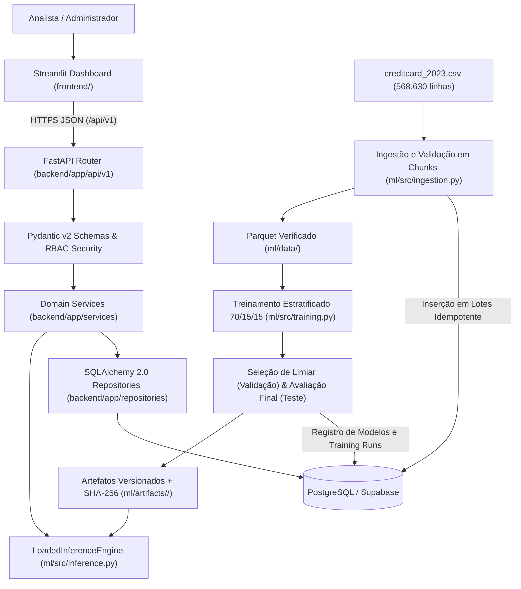

# Arquitetura Técnica — FraudGuard AI

## 1. Visão Geral e Estilo Arquitetural

O **FraudGuard AI** adota o padrão de **Monólito Modular para Aplicação + Pipeline Offline Independente** (ADR-001). Essa decisão evita a complexidade acidental de microserviços distribuídos para o escopo de um Mini Capstone, mantendo forte isolamento lógico entre camadas e garantindo reprodutibilidade ponta a ponta.

---

## 2. Responsabilidades por Camada

| Camada / Diretório | Responsabilidade | Restrições Arquiteturais |
|---|---|---|
| `frontend/` (Streamlit) | Apresentação gerencial, consulta paginada de transações, simulador interativo, revisão humana de alertas, comparação de modelos e disparo de importações. | **Jamais** acessa o banco de dados diretamente nem carrega arquivos `.joblib`. Comunica-se exclusivamente via HTTP/JSON com `/api/v1`. |
| `backend/app/api/v1/` | Contratos HTTP REST, serialização Pydantic v2, paginação padronizada, códigos de status semânticos e dependências de autenticação (`require_analyst`, `require_admin`). | Não contém consultas SQL diretas nem lógica de treinamento. |
| `backend/app/services/` | Orquestração transacional atômica (criação conjunta de `Transaction` + `Prediction` + `FraudAlert`), deduplicação por `request_id`, transições de estado de alertas e ativação exclusiva de modelo. | Garante `rollback` integral em caso de falha de modelo ou banco. |
| `backend/app/repositories/` | Consultas parametrizadas SQLAlchemy 2.0, paginação, filtros e agregações operacionais. | Isola o ORM das rotas HTTP. |
| `ml/src/` | Validação do CSV em chunks, geração de Parquet, auditoria de duplicatas, split estratificado 70/15/15 (`random_state=42`), treinamento de pipelines Scikit-learn, avaliação e inferência verificada por SHA-256. | Treinamento ocorre **somente offline via CLI/script**, nunca em endpoint HTTP público. |

---

## 3. Segurança, Autenticação e Observabilidade

1. **Controle de Acesso Baseado em Perfil (RBAC):**
   - **Analista:** acesso aos endpoints de consulta, simulação (`POST /predictions`) e revisão de alertas (`PATCH /alerts/{id}`).
   - **Administrador:** exigido obrigatoriamente para `POST /imports`, `GET /imports` e `POST /models/{id}/activate`. Nenhuma operação administrativa é exposta anonimamente (retorna `401 Unauthorized` ou `403 Forbidden`).
   - Suporta validação via cabeçalho `X-API-Key` ou `Authorization: Bearer <JWT>`.
2. **Integridade de Artefatos ML:**
   - Antes de carregar qualquer arquivo `pipeline.joblib`, `LoadedInferenceEngine` calcula o hash SHA-256 do arquivo em disco e confronta com o `artifact_sha256` registrado no banco/`metadata.json`, além de validar `feature_schema_version = "creditcard-2023-v1"` e a ordem exata das 29 features.
---

## 4. Análise Comparativa de Alternativas de Engenharia (Regras vs. ML Supervisionado vs. LLMs)

Uma decisão central de engenharia de software consiste em justificar **por que** determinada arquitetura de decisão foi escolhida frente às alternativas disponíveis no mercado. Na concepção do **FraudGuard AI**, avaliamos quatro abordagens sob três eixos críticos: **Custo (TCO / FinOps)**, **Eficácia (Acurácia/F1, Latência e Determinismo)** e **Facilidade de Implementação e Manutenção**:

| Dimensão de Engenharia | 1. Motor de Regras Heurísticas (`if/else` / SQL Rules) | 2. ML Supervisionado Linear (`LogisticRegression`) | 3. ML Supervisionado Ensemble (`RandomForestClassifier` — Escolhido) | 4. Modelos de Linguagem de Grande Porte (LLMs / GenAI) |
|---|---|---|---|---|
| **Custo de Infraestrutura e Operação (FinOps)** | **Compute:** Irrelevante (`~$0`). **Manutenção Humana:** **Alto.** Analistas precisam ajustar centenas de regras manualmente conforme padrões mudam. | **Compute:** Mínimo (`~$0` marginal/inferência; roda em CPU básica com `< 200 MB` RAM). **Retreinamento:** Segundos (`~2s`). | **Compute:** Baixo (`~$0` marginal/inferência; roda em CPU multi-core padrão sem GPU). **Retreinamento:** Rápido (`< 15s` com amostragem balanceada). | **Compute/API:** **Proibitivo em escala.** US$ 1.100 a US$ 5.600 por lote de 568 mil transações em APIs comerciais, ou alto custo de GPUs dedicadas (`vLLM`/`TGI`). |
| **Eficácia Técnica (F1, PR-AUC e Latência Medida)** | **Baixa eficácia multivariada** (`F1 ≈ 0,8412` na heurística estática). Regras univariadas falham quando a fraude combina desvios sutis em múltiplas variáveis `V1..V28`. **Latência:** `< 0,05 ms`. | **Boa eficácia linear** (`F1 = 0,9644`, `PR-AUC = 0,9945`, `1.129 FP` e `1.882 FN` no teste de 85.295 linhas). **Latência:** `p50 = 0,65 ms`, `p95 = 1,02 ms`. | **Eficácia superior** (`F1 = 0,9943`, `PR-AUC = 0,9998`, apenas `189 FP` e `297 FN` em 85.295 linhas — redução de **>83% nos erros** frente ao linear). **Latência:** `p50 = 16,99 ms`, `p95 = 21,79 ms`. | **Eficácia inferior para dados tabulares numéricos anonimizados.** LLMs não são otimizados para hiperplanos contínuos de 29 floats de PCA e não produzem probabilidades calibradas. **Latência:** `500 ms` a `3.500 ms` (inviável para autorização online). |
| **Facilidade de Implementação e Manutenção de Software** | **Curto prazo:** Muito fácil. **Médio/Longo prazo:** Difícil manutenção; colisão de regras, ausência de métrica probabilística contínua e alta fragilidade. | **Alta.** Pipeline Scikit-learn padronizado (`StandardScaler` + `LogisticRegression`), fácil teste unitário e serialização imutável. | **Alta.** Mesma abstração `Pipeline` do Scikit-learn, fácil encapsulamento em serviço REST FastAPI e verificação criptográfica SHA-256. | **Complexa e propensa a falhas.** Requer *prompt engineering*, *structured outputs*, *circuit breakers* para timeouts/rate-limits, mitigação de *prompt injection* e controle de deriva de versão do provedor. |

### 4.1 Análise Profunda dos Trade-offs e Vínculo com a Recomendação Final

1. **Trade-off Custo Inicial (CapEx) vs. Manutenibilidade e Custo em Escala (OpEx / FinOps):**
   - *Tensão:* Regras `if/else` têm implementação trivial no dia 1, mas geram dívida técnica exponencial conforme dezenas de exceções se acumulam. LLMs têm prototipação imediata via prompt, mas custo variável proibitivo em produção (**US\$ 1.137–US\$ 5.686 por lote de 568.630 transações**) e dependência de rede externa.
   - *Vínculo com a Recomendação:* A engenharia estruturada de um `Pipeline` **Scikit-learn local** paga seu CapEx inicial imediatamente, entregando **custo marginal zero (`~$0,00`) por predição** em CPU padrão e retreinamento completo reproduzível em `~10s`.
2. **Trade-off Assimetria de Erros — Falsos Positivos (Custo Operacional de Triagem) vs. Falsos Negativos (Fraude Perdida):**
   - *Tensão:* Regras estáticas univariadas deixaram passar **10.056 fraudes (`FN`)** no conjunto de teste (`Recall = 76,42%`). A `LogisticRegression` (`0.9.0-baseline`) capturou a relação linear (`FN = 1.882`), mas gerou **1.129 Falsos Positivos (`FP`)**, inflando a fila de revisão humana.
   - *Vínculo com a Recomendação:* O **`RandomForestClassifier` (`1.0.0`)** modela interações não-lineares de alta ordem entre `V1..V28` e `Amount`, reduzindo simultaneamente os **FP em 83,3% (`189`)** e os **FN em 84,2% (`297`)**, justificando sua escolha como modelo ativo oficial.
3. **Trade-off Latência (`p50`/`p95`) vs. Capacidade Preditiva:**
   - *Tensão:* O `RandomForest` (`p50 = 16,99 ms`, `p95 = 21,79 ms`) exige mais ciclos de CPU que a `LogisticRegression` (`p50 = 0,65 ms`, `p95 = 1,02 ms`).
   - *Vínculo com a Recomendação:* Em Engenharia de Software, `21,79 ms` no p95 cumpre com folga qualquer SLA síncrono (`< 100 ms`). Logo, trocar `~16 ms` de CPU por uma redução de `>83%` nos erros de negócio é o ponto ótimo de Pareto — mantendo a `LogisticRegression` versionada no banco como *fallback* de sub-milissegundo ativável via API (`POST /api/v1/models/{id}/activate`).
4. **Trade-off Interpretabilidade vs. Anonimização PCA (`V1..V28`):**
   - *Tensão:* Como `V1..V28` são projeções ortogonais anonimizadas via PCA, coeficientes lineares ou prompts de LLMs não oferecem semântica de negócio real (e LLMs tendem a alucinar explicações falsas).
   - *Vínculo com a Recomendação:* Descarta-se o uso de LLMs para explicação de features (ADR-004) e fundamenta-se a governança na combinação de **Regras Determinísticas de Contrato (Camada 1: Pydantic v2 + SQL)** + **Escore Calibrado `RandomForest` (Camada 2)** + **Limiar Operacional e Revisão Humana `fraud_alerts` (Camada 3)**.

---

## 5. Mapa Abrangente de Riscos (Software, Dados, ML e Uso de LLMs)

| Código | Categoria | Descrição do Risco e Falha Potencial na Implementação | Severidade | Mitigação Arquitetural Implementada no Projeto |
|---|---|---|---|---|
| **R-LLM-01** | **Uso de LLMs (Produto)** | **Alucinação Explicativa sobre Features Anonimizadas:** Se um LLM for usado para justificar um alerta, ele tende a inventar narrativas falsas sobre `V1..V28` (cujos nomes reais foram removidos por PCA), induzindo analistas a erros graves. | **Crítica** | Exclusão de LLMs da geração de laudos sobre `V1..V28` (ADR-004). O dashboard reporta estritamente variáveis reais (`fraud_score`, `threshold`, versão do modelo e métricas empíricas). |
| **R-LLM-02** | **Uso de LLMs (Produto)** | **Não-Determinismo e Quebra de Auditoria:** Chamadas repetidas a um LLM com o mesmo vetor numérico podem divergir por amostragem estocástica ou atualização silenciosa do endpoint remoto. | **Alta** | Uso de `LoadedInferenceEngine` com `Pipeline` Scikit-learn determinístico (`random_state=42`) e validação de hash **SHA-256** a cada inicialização. |
| **R-LLM-03** | **Uso de LLMs (Infra/SLA)** | **Latência Alta, Timeouts e Rate Limiting (HTTP 429):** Dependência de API externa de LLM no endpoint `POST /predictions` causaria gargalos de segundos por transação e quedas em cascata. | **Alta** | Inferência 100% local em memória RAM (CPU), atingindo `p50 = 0,65 ms` (LogReg) e `p50 = 16,99 ms` (RandomForest), sem dependência de rede externa. |
| **R-LLM-04** | **Uso de LLMs (Segurança)** | **Prompt Injection Indireto e Exfiltração de Dados:** Campos como `notes` ou `request_id` poderiam conter instruções adversariais caso fossem concatenados em prompts de triagem automática. | **Alta** | Transições de alerta governadas por dicionário estático `ALLOWED_ALERT_TRANSITIONS` e tipagem estrita `Literal` no Pydantic; nenhum dado é enviado a provedores terceiros de IA. |
| **R-LLM-05** | **Uso de LLMs (Eng. Software)** | **Erros Gerados por Assistentes de Código IA (*Vibe Coding* / Regressões):** Geração acidental de código com *data leakage* (`StandardScaler` ajustado no dataset inteiro), rotas sem autenticação ou commits parciais. | **Alta** | Regras estritas em `AGENTS.md`, testes automatizados (`test_unit.py`, `test_ml.py`, `test_integration_api.py`), linter `ruff` em CI (`.github/workflows/ci.yml`) e validação de rollback transacional. |
| **R-SWE-01** | **Banco / Transações** | **Gravação Parcial (Inconsistência de Estado):** Falha após gravar `Transaction` mas antes de gravar `Prediction`/`FraudAlert`. | **Crítica** | Persistência atômica em `PredictionService.create_prediction` com `db.commit()` único e `db.rollback()` em bloco `try/except`, coberto por teste de falha simulada. |
| **R-SWE-02** | **Concorrência / Estado** | **Mais de um Modelo Ativo Simultaneamente:** Duas chamadas concorrentes de ativação deixarem duas linhas com `is_active = TRUE`. | **Alta** | Índice parcial único no PostgreSQL/SQLite (`uq_one_active_model WHERE is_active = TRUE`) e desativação transacional prévia. |
| **R-SWE-03** | **Performance / Memória** | **Estouro de Memória (OOM) ao Importar 568.630 Linhas:** Leitura integral em memória no processo web. | **Alta** | Streaming em chunks (`pd.read_csv(chunksize=10_000)`), execução assíncrona (`202 Accepted`) e inserção em lote idempotente (`ON CONFLICT DO NOTHING`). |
| **R-ML-01** | **Ciência de Dados** | **Data Leakage via `id` ou `Class`:** O campo `id` do CSV original é fortemente correlacionado com a classe, gerando acurácia ilusória se incluído em `X`. | **Crítica** | Bloqueio explícito de `id` e `Class` em `extract_X_y` e nos schemas Pydantic (`FORBIDDEN_FEATURE_COLS`), garantido por testes automatizados. |
| **R-ML-02** | **Ciência de Dados** | **Ilusão de Prevalência (Base 50%/50%):** Assumir que a taxa de falsos positivos do dataset balanceado se repetirá no mundo real (`< 0,2%` de fraude). | **Alta** | Documentação explícita da limitação metodológica no README, PRD, API e interface Streamlit, evitando afirmações enganosas de "fraude comprovada". |

