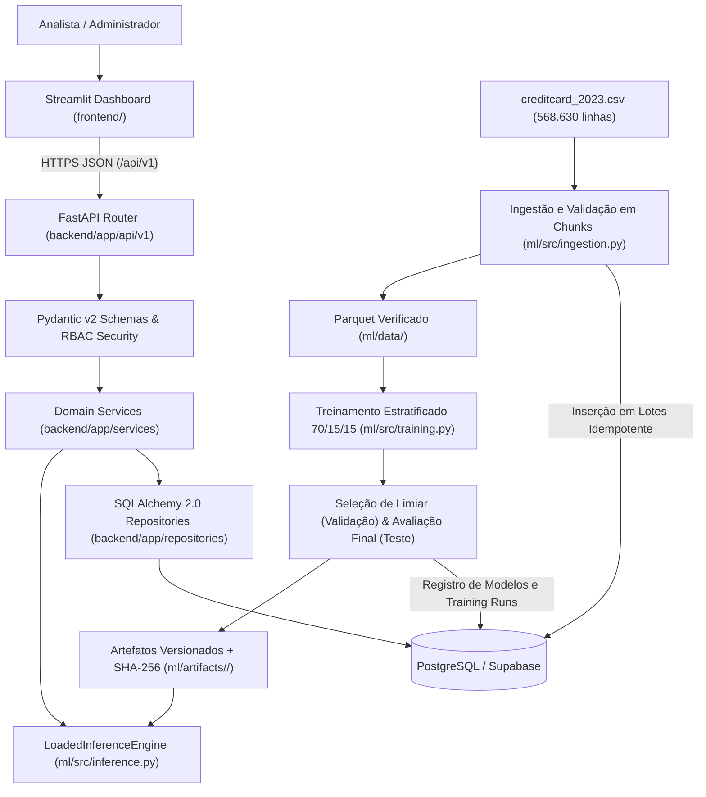

# Arquitetura Técnica — FraudGuard AI

## 1. Visão Geral e Estilo Arquitetural

O **FraudGuard AI** adota o padrão de **Monólito Modular para Aplicação + Pipeline Offline Independente** (ADR-001). Essa decisão evita a complexidade acidental de microserviços distribuídos para o escopo de um Mini Capstone, mantendo forte isolamento lógico entre camadas e garantindo reprodutibilidade ponta a ponta.

---

## 2. Responsabilidades por Camada

| Camada / Diretório | Responsabilidade | Restrições Arquiteturais |
|---|---|---|
| `frontend/` (Streamlit) | Apresentação gerencial, consulta paginada de transações, simulador interativo, revisão humana de alertas, comparação de modelos e disparo de importações. | **Jamais** acessa o banco de dados diretamente nem carrega arquivos `.joblib`. Comunica-se exclusivamente via HTTP/JSON com `/api/v1`. |
| `backend/app/api/v1/` | Contratos HTTP REST, serialização Pydantic v2, paginação padronizada, códigos de status semânticos e dependências de autenticação (`require_analyst`, `require_admin`). | Não contém consultas SQL diretas nem lógica de treinamento. |
| `backend/app/services/` | Orquestração transacional atômica (criação conjunta de `Transaction` + `Prediction` + `FraudAlert`), deduplicação por `request_id`, transições de estado de alertas e ativação exclusiva de modelo. | Garante `rollback` integral em caso de falha de modelo ou banco. |
| `backend/app/repositories/` | Consultas parametrizadas SQLAlchemy 2.0, paginação, filtros e agregações operacionais. | Isola o ORM das rotas HTTP. |
| `ml/src/` | Validação do CSV em chunks, geração de Parquet, auditoria de duplicatas, split estratificado 70/15/15 (`random_state=42`), treinamento de pipelines Scikit-learn, avaliação e inferência verificada por SHA-256. | Treinamento ocorre **somente offline via CLI/script**, nunca em endpoint HTTP público. |

---

## 3. Segurança, Autenticação e Observabilidade

1. **Controle de Acesso Baseado em Perfil (RBAC):**
   - **Analista:** acesso aos endpoints de consulta, simulação (`POST /predictions`) e revisão de alertas (`PATCH /alerts/{id}`).
   - **Administrador:** exigido obrigatoriamente para `POST /imports`, `GET /imports` e `POST /models/{id}/activate`. Nenhuma operação administrativa é exposta anonimamente (retorna `401 Unauthorized` ou `403 Forbidden`).
   - Suporta validação via cabeçalho `X-API-Key` ou `Authorization: Bearer <JWT>`.
2. **Integridade de Artefatos ML:**
   - Antes de carregar qualquer arquivo `pipeline.joblib`, `LoadedInferenceEngine` calcula o hash SHA-256 do arquivo em disco e confronta com o `artifact_sha256` registrado no banco/`metadata.json`, além de validar `feature_schema_version = "creditcard-2023-v1"` e a ordem exata das 29 features.
3. **Logs Estruturados (RNF-04):**
   - Middleware HTTP injeta e propaga `X-Request-ID`, registrando método, caminho, código HTTP e latência em milissegundos em formato JSON estruturado, mascarando automaticamente campos sensíveis (`password`, `secret`, `token`, `key`).

