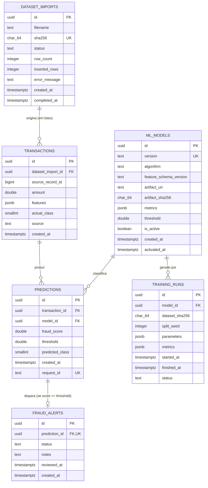

# Modelo de Dados e Persistência — FraudGuard AI

## 1. Visão Geral

O **FraudGuard AI** utiliza **PostgreSQL** (gerenciado pelo **Supabase** em nuvem ou container `postgres:16-alpine` via Docker Compose em desenvolvimento local), acessado via **SQLAlchemy 2.0** (`psycopg 3`) e versionado por migrações **Alembic** (`backend/alembic/versions/0001_initial_schema.py`).

---

## 2. Diagrama Entidade-Relacionamento (ERD)



---

## 3. Invariantes, Índices e Regras de Integridade

1. **Modelo Único Ativo (`uq_one_active_model`):**
   - Índice parcial único:
     ```sql
     CREATE UNIQUE INDEX uq_one_active_model ON ml_models (is_active) WHERE is_active = TRUE;
     ```
   - Garante no nível do SGBD que jamais existam dois modelos simultaneamente ativos. A troca de modelo ativo ocorre de forma transacional em `ModelService.activate_model`.
2. **Idempotência de Importação (`dataset_imports` e `transactions`):**
   - `dataset_imports.sha256` é `UNIQUE`, impedindo reimportação acidental do mesmo arquivo CSV (`409 Conflict`).
   - `UNIQUE (dataset_import_id, source_record_id)` em `transactions` garante que a importação em lotes (`ON CONFLICT DO NOTHING`) possa ser retomada sem duplicar linhas.
3. **Atomicidade na Inferência (`POST /api/v1/predictions`):**
   - A inserção de `Transaction`, `Prediction` e `FraudAlert` (quando `predicted_class = 1`) ocorre dentro de uma única transação SQL. Qualquer erro faz `rollback` completo.
4. **Semântica Temporal (`created_at`):**
   - O dataset `creditcard_2023.csv` não possui timestamp real da compra. Todos os campos `created_at` representam estritamente o **momento de ingestão/registro** no banco.
5. **Conexão com Supabase:**
   - Aplicação utiliza `DATABASE_URL` (suportando Connection Pooler com `?sslmode=require`).
   - Migrações Alembic suportam `DIRECT_DATABASE_URL` para conexão direta na porta `5432`.

